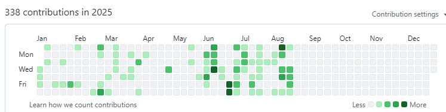
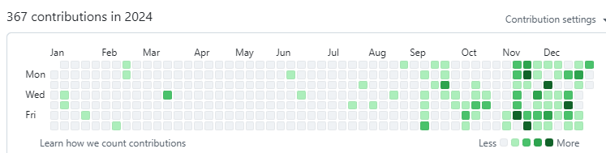
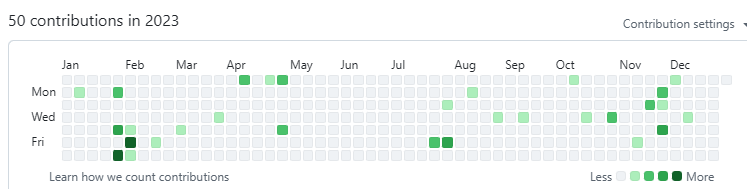
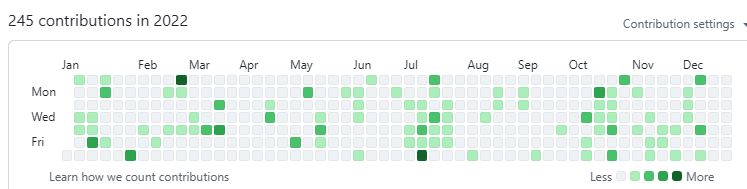
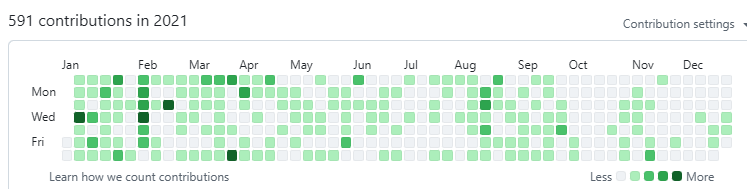

### Hi there 👋 I'm veaba

Frontend / full-stack engineer. I build tooling, CI pipelines and developer-facing
infrastructure — mostly where **Vue**, **Node/Bun**, **Rust** and **AI agents** meet.

**Blog** · [veaba.me](https://www.veaba.me)

#### What I work on

- 🧩 **Vue.js org member** — admin of [`vuejs-translations/docs-zh-cn`](https://github.com/vuejs-translations/docs-zh-cn)
  (the official Chinese documentation for Vue 3). I review PRs and maintain the
  automation behind it.
- 🤖 **AI-powered i18n pipeline** — designed the `auto-pr` / `autosync` / `automerge`
  workflows that detect upstream changes in `vuejs/docs`, drive an AI CLI to translate,
  auto-resolve conflicts and open reviewed PRs end to end.
- 🛠️ **Multi-runtime tooling** — [`@veaba/qrcodes`](https://github.com/veaba/qrcodes)
  (Rust / WASM / Node / Bun) and [`electron-rsbuild`](https://github.com/electron-rsbuild/electron-rsbuild)
  (Electron tooling built on Rsbuild).
- 📝 **Docs infrastructure** — VitePress, VuePress, static-site editing and translation
  tooling across the Vue ecosystem.

#### Numbers

- Contributing to the Vue ecosystem since **2016** (started with the Vue 2 official
  Chinese docs translation); Vue.js org member
- **128 merged pull requests** and **93 pull requests reviewed** across the official
  Vue repositories
- Contributions to `vuejs/docs`, `vuejs/core`, `vuejs-translations/docs-zh-cn`
- Personal open-source projects with **370+ stars** combined
  (incl. [`ncov`](https://github.com/veaba/ncov), 247★)

#### Currently

- 🔭 Building developer tooling for AI coding agents
- 🌱 Sharpening Rust and systems-level programming
- 💬 Ask me about Vue internals, i18n automation, CI/CD, or agent tooling

  
  
  
  
  

<!--
**veaba/veaba** is a ✨ _special_ ✨ repository because its `README.md` (this file) appears on your GitHub profile.
-->
